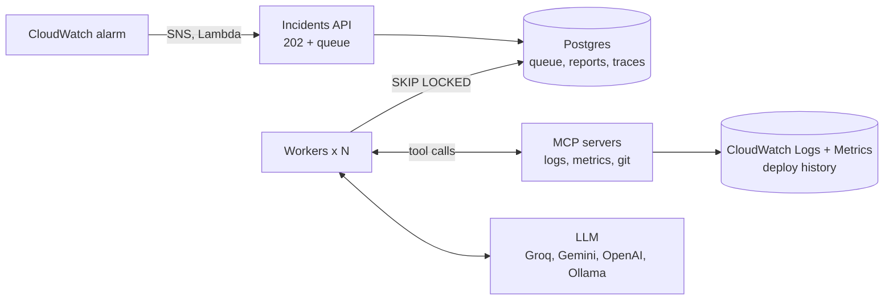

# OpsPilot

**An AI on-call agent that investigates production incidents.** When an alarm fires,
OpsPilot reads logs, metrics and recent deploys through MCP tools and returns a
root-cause report in which every piece of evidence is copied from real tool output.
It never changes anything: it investigates and recommends, and a human acts.


> Demo video: _coming soon_

## How it works



1. A demo **shop** service (FastAPI + Postgres) writes one JSON log line per request.
2. A **fault switch** breaks it realistically: slow DB, bad config, memory leak, buggy deploy, or stock exhaustion (a business issue, not an outage).
3. An **alarm** creates an incident. The API returns `202` and queues it.
4. A **worker** claims it and runs the **agent loop**: the LLM calls read-only MCP tools (`count_errors`, `search_logs`, `get_metric`, `recent_commits`, `commit_diff`) under hard budgets for tool calls, tokens and time.
5. The report is **schema-validated** and **grounded**: evidence that does not appear in real tool output is dropped and confidence is lowered.
6. An **eval suite** replays staged incidents and gates CI on accuracy.

### Example trace

From an end-to-end run of the real services (shop, MCP servers over HTTP, API,
Postgres queue, worker) with a **scripted** model standing in for the LLM:

| Step | Tool | Result |
| --- | --- | --- |
| 1 | `count_errors(group_by=error_type)` | 51 errors, all `KeyError` |
| 2 | `recent_commits(hours=2)` | `release v1.5.0: apply promotion discounts to order totals` |
| 3 | `search_logs("status>=500 path=/orders")` | 51 matching lines, newest first |

The scripted answer included one fabricated evidence line on purpose; the grounding
check removed it and lowered confidence from `high` to `medium`.

## Evaluation

8 staged scenarios with ground truth (one per fault, a noisy variant, a low-traffic
variant, a business case, and a healthy control). See [evals/README.md](evals/README.md).

| Date | Model | Accuracy | Grounded | Notes |
| --- | --- | --- | --- | --- |
| | | | | first live run pending |

## Run it locally

```bash
cp .env.example .env            # fill in secrets + an LLM API key (Groq/Gemini free tiers work)
make install                    # pip install -e ".[dev]"
make demo-history
make up                         # docker compose: db, shop, 3 MCP servers, api, 2 workers
```

Then follow [docs/runbook.md](docs/runbook.md) to break the shop and watch an investigation.

```bash
make test                       # unit + MCP + agent tests (Postgres tests skipped)
make test-pg                    # everything, against a throwaway Postgres in Docker
make lint
```

`make test-pg` needs Docker running and port 5435 free. It starts a disposable
`postgres:16-alpine` container, waits until it accepts connections, runs the whole
suite with `TEST_DATABASE_URL` pointing at it, and stops the container afterwards,
even when tests fail or you press Ctrl-C. To use your own database instead:
`TEST_DATABASE_URL=postgresql+psycopg://... make test`. Override the port with
`make test-pg PG_TEST_PORT=5436`.

## Deploy to AWS

Terraform for EC2, CloudWatch metric filters and alarms, SNS, an in-VPC Lambda alarm
forwarder, SSM secrets, budget alerts and a GitHub OIDC deploy role:
[infra/README.md](infra/README.md).

## Design

- [docs/architecture.md](docs/architecture.md): components, incident lifecycle, design
  decisions and trade-offs, failure modes, scaling path, AI roadmap, security model
- [docs/decisions.md](docs/decisions.md): my own notes on each decision

Highlights:
- **Async API + Postgres job queue** with dedup (partial unique index), `SKIP LOCKED`
  claims, leases, fencing and retries with backoff
- **Stateless MCP servers** over streamable HTTP with pluggable local/AWS backends
- **Provider-agnostic LLM layer** with its own retry policy and token accounting
- **Safety**: read-only tools, whitelisted query language, output caps, secret
  redaction, untrusted-output wrapping, grounding check
- **CI/CD**: lint, tests with a Postgres service, offline eval gate, Terraform
  validate, Docker build; deploys via GitHub OIDC + SSM (no SSH keys)

## Project layout

```text
common/        JSON logging, correlation ids, redaction
shop/          demo service + fault injection
mcp_servers/   logs, metrics, git MCP servers; backends/local.py, backends/aws.py
opspilot/      llm/ (providers), agent/ (loop, prompts, report, grounding),
               api/ (incidents API), worker/ (queue consumer), db/ (models, queue)
migrations/    Alembic
evals/         scenarios, runner (live + offline replay), scoring
scripts/       load generator, fault injector, simulated deploy history
infra/         Terraform, Lambda alarm forwarder
```

## Limitations

- The incidents are staged in a demo service; real systems are noisier.
- Fault state lives in one shop process (fine for one container).
- Offline evals replay recorded model behaviour; a prompt or model change needs a
  new live run to be measured.
- The deploy history in the demo is simulated (a separate git repo), clearly labelled.

## Tech stack

Python 3.12 · FastAPI · SQLAlchemy 2 · Alembic · Postgres 16 · MCP Python SDK ·
OpenAI-compatible LLM APIs · Docker Compose · AWS (EC2, CloudWatch, SNS, Lambda, SSM,
IAM, Budgets) · Terraform · GitHub Actions · pytest · ruff
