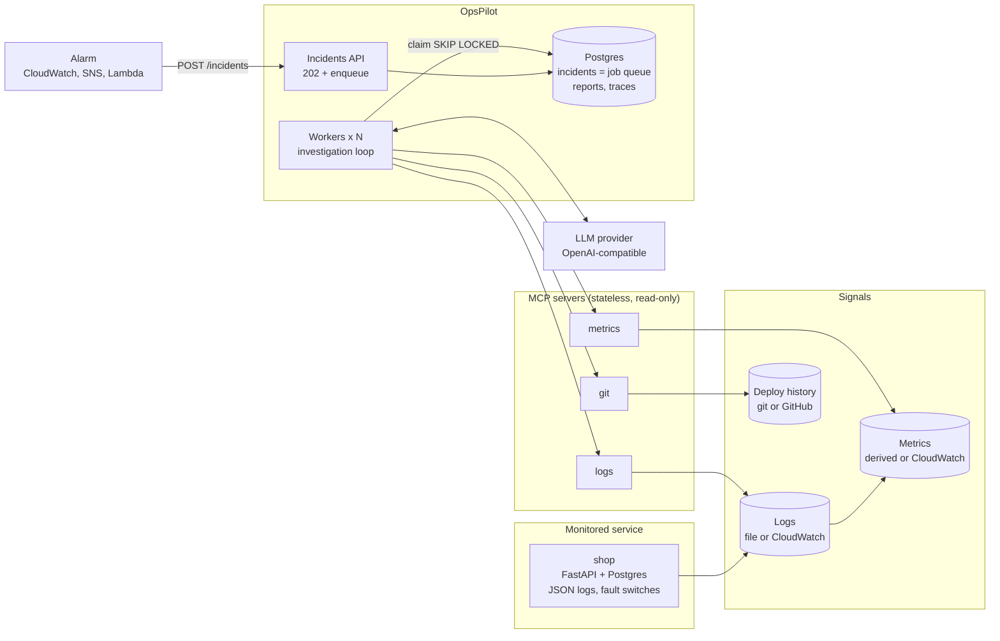
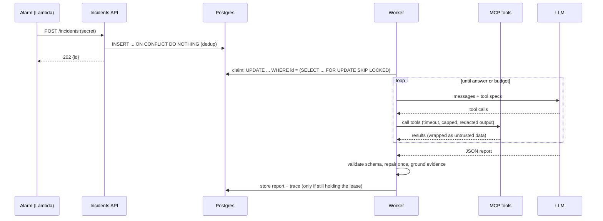

# OpsPilot architecture

OpsPilot turns an alarm into a root-cause report with evidence, using an LLM that can
only read: logs, metrics and deploy history, through MCP tools.

## Goals and non-goals

| Goals | Non-goals (for now) |
| --- | --- |
| First-pass investigation within ~1 minute of an alarm | Fixing anything automatically |
| Every claim backed by evidence copied from real tool output | Replacing on-call engineers |
| Measurable quality (evals in CI) | Supporting every log/metrics vendor |
| Runs cheaply on one small instance, scales out without a redesign | Multi-tenant SaaS |

## Components

## Incident lifecycle

## Key design decisions

| Decision | Why | Trade-off |
| --- | --- | --- |
| API returns **202** and enqueues; workers investigate | Investigations take 10-60 s; the API stays fast and scales separately | Clients poll `GET /incidents/{id}` |
| **Postgres as the job queue** (`FOR UPDATE SKIP LOCKED`) | One fewer system to run; transactional with the data | Fine to thousands of jobs/min; beyond that use SQS (only `db/queue.py` changes) |
| **Dedup** with a partial unique index + `ON CONFLICT` | Alarms flap; two arrivals at the same instant must not create two jobs | One open incident per (service, alarm) |
| **Leases + fencing** | A crashed worker's job is re-claimed; a slow, expired worker cannot overwrite the new attempt | At-least-once: a job may run twice, so results are idempotent (upsert) |
| **MCP over stateless streamable HTTP** | Tools are separate services, reusable by any MCP client, scalable behind a load balancer | Network hop per tool call |
| **Backend protocol** (local or AWS) per MCP server | Build and test everything locally; switch to CloudWatch with one env var | Two implementations to keep in sync |
| **Provider-agnostic LLM layer** | Any OpenAI-compatible API (Groq, Gemini, OpenAI, Ollama); swap by config | Lowest common denominator of features |
| **Budgets in code** (tool calls, tokens, wall clock) | An agent that can loop is a cost and reliability incident | May stop before a hard case is solved: reported as `partial` |
| **Grounding check** | Evidence must appear in real tool output; otherwise dropped and confidence lowered | Paraphrased evidence is dropped too |
| **Read-only agent** | Removes most of the risk of an LLM near production | A human applies the fix |
| **One image, many roles** | Same artifact in dev, CI and prod | Image contains code for every role |

## Failure modes

| Failure | Behaviour |
| --- | --- |
| LLM rate limit / 5xx | Retry with exponential backoff + jitter (3 attempts), then the job fails with the reason |
| LLM auth or bad request | Fail fast, no retry |
| Invalid JSON report | One repair round with the validation error; then `failed` |
| A tool errors or times out | Error returned to the model as the tool result; investigation continues |
| MCP server unreachable | Job re-queued with backoff (10 s, 20 s, ...) up to `max_attempts` |
| Worker crashes mid-job | Lease expires; another worker re-claims |
| Budget exhausted | Model is asked for a final answer without tools; report marked `partial` |
| Prompt injection in logs | Output wrapped as untrusted data; agent has no write tools to abuse |

## Scaling path

| Stage | Change |
| --- | --- |
| Today: 1 service, 1 instance | Compose on EC2; 2 workers |
| 10 services | More worker replicas (`--scale worker=N`); MCP servers take a `service` argument; RDS instead of a container DB |
| 100 services | ECS/Fargate per role, autoscale workers on queue depth; MCP servers behind an internal ALB; queue moves to SQS; per-service tool permissions |
| Many teams | Tenant id on incidents and tools; per-tenant budgets and model choice |

Because the API, workers and MCP servers hold no local state, each step is packaging
and configuration, not a rewrite.

## AI integration roadmap

1. **Model routing:** a small, fast model for the first pass; escalate to a larger one
   when confidence is low (the provider layer already isolates this).
2. **Incident memory:** store past reports and postmortems with embeddings (pgvector,
   same Postgres) and give the agent a `similar_incidents` tool.
3. **Runbook retrieval:** an MCP server over runbooks so suggested fixes cite the
   team's own procedures.
4. **Human-in-the-loop actions:** proposed actions (rollback, restart) require an
   explicit approval in Slack; the agent itself stays read-only.
5. **Observability for the agent:** OpenTelemetry spans per tool call and LLM call;
   dashboards for cost per incident, latency and accuracy over time.
6. **Continuous evaluation:** every prompt or model change runs the live eval suite;
   the offline replay gate already runs on every pull request.

## Security model

- Agent and instance role are read-only; no tool can change infrastructure.
- Tool inputs are schema-validated; the log filter language is whitelisted, so no
  raw model text reaches a CloudWatch query or a shell.
- Tool output is size-capped and secret/PII-redacted before the model sees it.
- Secrets: env vars from `.env` locally; SSM SecureString in AWS; never in code or logs.
- API and admin endpoints use shared secrets compared in constant time.
- MCP HTTP servers enforce allowed Host headers (DNS-rebinding protection).
- Containers run as a non-root user; EC2 uses IMDSv2 only and an encrypted disk.
- Deploys use GitHub OIDC + SSM Run Command: no SSH keys in CI.
